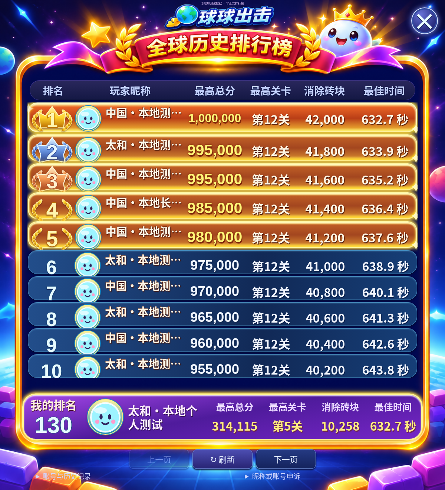

# 全球历史排行榜：参考图重制版

> 这是参考图版本的设计记录。当前弹窗高度、个人栏和提交协议以 [后续修复说明](SUBMISSION_PROTOCOL_LAYOUT_FIX.md) 为准，移动端不再锁定十行固定画布。

## 最终版式

按用户提供的画面重做，取消上一版独立竖向卡片：

- 顶部地球游戏徽标、红金绶带标题、月桂、星星、皇冠球球。
- 深蓝星空、金色发光外框、底部霓虹地面和砖块。
- 六列对齐：排名 / 玩家昵称 / 最高总分 / 最高关卡 / 消除砖块 / 最佳时间。
- 首屏10行：前三名金银铜徽章，前五行金橙色渐变和金光，第6名起蓝色行。
- 底部固定紫金「我的排名」成绩栏；刷新、分页、账号与申诉保留，不遮盖数据。

`ReferenceLayout.ts` 统一1200×1320逻辑坐标、六列宽度、行高、表头、列表视口和个人栏。Web使用容器单位，微信Canvas使用同一几何等比例缩放。前10行恰好填满列表视口，其余条目可滚动查看；每次仍请求原API的20条，全部TOP100可分页访问。

静态插画由图像工具按参考图重制，不声称原图逐像素校验相同。参考中的示例玩家照片、姓名、名次和成绩没有烘焙入图片，也不会用于冒充真实玩家。无真实头像时沿用统一球球默认头像。

## 数据与交互

仍读取 `/leaderboard?board=global&offset=…&limit=20`、`/me?board=global`，不计算排名、不客户端重排同分成绩。TOP100之外的个人名次也直接取服务器值；未登录、未上榜和读取失败分别展示，缺失指标显示「—」。

列表按参考图显示一位小数的秒数；精确毫秒仍保留在共享数据、网页时间title和微信详情中，排序和服务端验证不变。长昵称可点击展开或在微信详情查看。百万分数自动适配列宽，不截断数字。

挑战结束后仍可提交、跳过、查看榜单，并从榜单返回本次挑战成绩。提交失败恢复按钮，保留原日志和幂等重试。原有昵称、地区、微信账号绑定、历史记录和申诉流程保留。

没有改动服务端代码、SQLite、身份、历史成绩、排序、ChallengeJournal、物理规则或规则版本。

## 双端资源与性能

- Web：`public/ranking-art/reference-scene.png`，Vite随静态资源发布。
- 微信：构建时将同一图片复制到`dist/assets/ranking-scene.png`，由微信Image本地加载；构建测试检查资源存在。
- 金色流光、星芒有数量上限，暂停、后台或减少动态偏好下停止。低配设备和持续低帧率自动降档。
- 微信静态场景、文字、徽章使用一个可复用离屏画布；只有滚动、视口、数据或图片状态变化才重绘。低配缓存DPR为1，其他最高为2；动画仅绘制少量叠加效果。
- 不创建额外游戏物理帧循环，不修改Game.update或计时；被排行榜完全遮住的竞技场不重复绘制。

最终开发环境Chromium各45帧短采样，完整数据见`work/galactic-ranking/results.json`：

| 客户端 / 视口 | 平均FPS | 最大帧间隔 |
| --- | ---: | ---: |
| Web 1200×1320 | 60.00 | 16.8ms |
| Web 1366×1000 | 60.01 | 16.7ms |
| Web 390×844 | 60.00 | 16.7ms |
| Web 320×568 | 60.00 | 16.8ms |
| 微信模拟 390×844 | 60.01 | 16.8ms |
| 微信模拟 320×568 | 60.00 | 16.8ms |
| 微信模拟 768×1024 | 60.00 | 16.8ms |

以上是开发环境软件浏览器采样，不是低端安卓或iPhone真机性能保证；各样本的物理日志tick均未被视觉动画推进。

## 测试与构建

```bash
npm run typecheck
npm test
npm run build
npm run test:wechat
npm run test:minigame
npm run typecheck --prefix server
npm test --prefix server
npm run build --prefix server
# 启动本地预览后，在另一终端运行
npm run preview -- --port 4173
npm run test:browser:galactic
node tests/browser-power-submission.mjs
npm run test:browser:wechat
```

前端239项、后端63项、微信与兼容小游戏工程各5项通过；前后端类型检查、Web与两套小游戏构建通过。覆盖参考几何、首屏10行、数值完整性、滚动、静态缓存复用、空榜、加载/失败、长昵称、并列成绩、个人名次、暂停和后台动画停止。

7组浏览器视口/客户端交互通过：Web 1200×1320、1366×1000、390×844、320×568；微信Canvas模拟390×844、320×568、768×1024。原有成绩提交失败重试、查看榜单后返回成绩登记的浏览器回归通过。微信打包客户端连接本地隔离SQLite API的兼容性回归保留。

微信测试是Chromium模拟宿主和无DOM夹具，不替代官方开发者工具、安卓/iPhone真机验收。真实字体、系统授权、安全区和低端GPU仍需真机补验。

## 效果截图

**以下均使用明确标记的本地测试数据，不是正式榜单；测试夹具未进入客户端构建，也未写入生产数据。**

- [完整参考尺寸](screenshots/reference-web-full.png)
- [网页手机](screenshots/reference-web-mobile.png)
- [微信Canvas手机模拟](screenshots/reference-wechat-mobile.png)



## 修改文件

共享视觉：`src/online/ranking/Presentation.ts`、`ReferenceLayout.ts`、`Artwork.ts`、`WebCards.ts`、`ranking.css`、`reference.css`。网页协调：`src/online/LeaderboardUI.ts`。

微信：`wechat-game/src/RankingCanvas.ts`、`App.ts`、`Panel.ts`、`Platform.ts`、构建脚本及构建测试。旧`minigame`目录继续复用同一客户端。

资源：`public/ranking-art/reference-scene.png`及说明。测试：排行榜展示/Canvas/参考几何、浏览器场景、提交回归、明确标记的本地夹具；旧浏览器脚本同步卡片选择器。命令、README、本说明和截图同步更新。

未安装game-ui-design/game-feel技能。没有部署、修改生产配置、数据库或《统帅三国》。审核通过后仅需按现有保留数据库的正常客户端发布流程更新，后端无需迁移。
