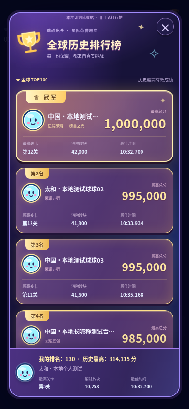
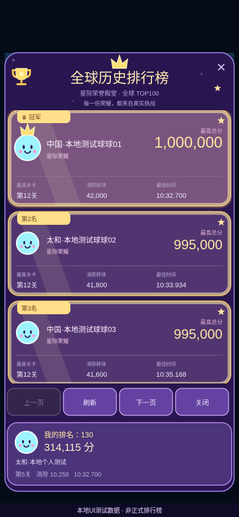
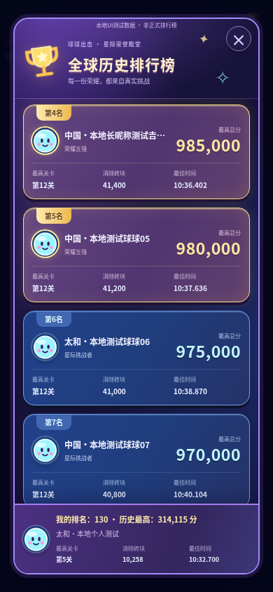
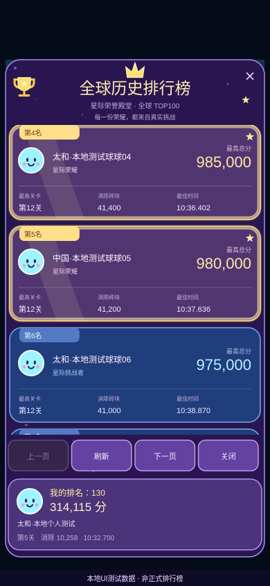

# 全球历史排行榜：星际荣耀 UI

## 范围与视觉

`game-ui-design`、`game-feel` 均未安装；本次直接实现原创 Canvas / SVG / CSS 视觉，不引用未经授权的素材、头像或外部字体。

紫蓝星际圆角面板、金色奖杯、皇冠与星星。前5名采用金色描边与柔和光晕、流光和星芒，第1名的皇冠、字号、头像框和光晕更突出；第6名以后是蓝色卡片。每张卡显示服务端的地区昵称、排名、最高总分、最高关卡、消除砖块和最佳时间；时间显示到毫秒（分:秒.毫秒），避免同分成绩在视觉上无法区分。

两端均使用 `src/online/ranking/Presentation.ts` 的只读展示模型、配色令牌、时间/数字格式、荣耀判断与降档时钟，`Artwork.ts` 提供原创球球默认头像、奖杯和皇冠图形。所有玩家使用同一个默认头像，不模拟真实玩家照片。

网页为可滚动卡片列表 + 始终可见的个人排名底栏；微信为独立 Canvas 卡片面板、手指拖动滚动、分页按钮和固定个人卡。微信昵称过长可点卡片查看完整记录，拖动不会误触卡片。网页以省略号显示过长昵称，点击球球头像/名称或按键盘回车可展开完整名称，同时提供完整 title。

## 数据及游戏保护

- 继续使用原 `/leaderboard?board=global&offset=…&limit=20` 和 `/me?board=global`，每次最多20条、总榜TOP100。微信页大小从按屏幕取3/5改为20，仍遵守原API分页约束。
- 直接展示服务器的 rank，不从当前页或分数自行计算；同分、并列名次不重排。个人在TOP100之外，仍展示 `/me` 的真实排名。
- 分别展示未上榜、未登录、个人记录不可用；请求失败时不伪装成未上榜。缺失指标显示「—」，不编造为0。
- 原有昵称登记、微信绑定、历史记录、申诉、成绩提交及安全重试继续保留。旧历史记录仍在账号详情中，没有删除数据或增加赛季入口。
- 不改服务端、SQLite、排序规则、玩家身份、成绩、ChallengeJournal、规则版本和玩法。只对已被微信排行榜完全遮住的竞技场跳过无效绘制，Game.update/物理流程不变。

## 动效与性能

网页只通过 CSS transform / opacity 动画，不引入排行榜RAF循环或JS粒子池。按硬件线程/内存、窄屏和用户减少动态偏好降档，并利用现有游戏帧回调监测持续低帧率。

微信通过设备 benchmarkLevel、窄屏和实际显示帧时间降档：背景星芒从24减为6，减少阴影，关闭流光；仅绘制可见卡片。视图暂停时冻结动效时间，进入后台使用原有生命周期停止帧循环。网页暂停、后台或关闭弹窗也停止动画。

初次大尺寸软件渲染采样发现掉帧，已缩小流光面积、移除整屏背景模糊，跳过微信被遮挡的竞技场绘制；不通过调整物理时间或规则优化。最终 Chromium 45帧短采样：

| 客户端/视口 | 平均FPS | 最大帧间隔 |
| --- | ---: | ---: |
| Web 1366×1000 | 60.00 | 16.8ms |
| Web 390×844 | 60.00 | 16.8ms |
| Web 320×568 | 60.01 | 16.8ms |
| 微信模拟 390×844 | 59.99 | 16.8ms |
| 微信模拟 320×568 | 60.01 | 16.8ms |
| 微信模拟 768×1024 | 58.69 | 33.4ms |

短采样仅反映本开发环境的 Chromium，不证明真机稳定60FPS。所有样本检查了排行榜期间物理日志 tick 不受视觉动画推进。完整JSON与额外空榜/错误截图位于忽略提交的 `work/galactic-ranking/`。

## 验证与复现

```bash
npm run typecheck
npm test
npm run build
npm run test:wechat
npm run test:minigame
npm run typecheck --prefix server
npm test --prefix server
npm run build --prefix server
# 启动本地预览，另一终端运行UI浏览器测试
npm run preview -- --port 4173
npm run test:browser:galactic
# 真实打包微信客户端连接本地隔离SQLite API的兼容性测试
npm run test:browser:wechat
# 提交失败、日志保留和幂等重试的既有回归
node tests/browser-power-submission.mjs
```

前端235项、后端63项、微信工程5项和兼容小游戏工程5项通过，前后端类型检查、Web与两套小游戏构建通过。

新增11项逻辑/Canvas测试，以及6种浏览器视口/客户端场景，覆盖前5荣耀、普通蓝卡、空榜、加载/失败、超长Unicode昵称、并列分数/名次、未上榜/未登录、真实个人排名130、分页刷新、固定底卡、拖动、低配降档和暂停/后台停止动画。既有成绩提交故障重试浏览器回归通过。

微信浏览器测试使用 Chromium 微信API模拟宿主，不等于官方开发者工具或安卓/iPhone真机验收；真机字体、GPU、触摸与低端性能仍需补验。

## 效果截图

**截图均明确标注本地 UI 测试数据，不是正式玩家、正式成绩或生产榜单；测试夹具从不进入发布客户端。**

| 网页版 | 微信 Canvas 模拟 |
| --- | --- |
|  |  |
|  |  |

## 修改文件

- 共享视觉：`src/online/ranking/Presentation.ts`、`Artwork.ts`。
- 网页：`src/online/LeaderboardUI.ts`、`src/online/ranking/WebCards.ts`、`ranking.css`。
- 微信：`wechat-game/src/RankingCanvas.ts`、`App.ts`、`Panel.ts`、`Platform.ts`；旧 `minigame` 兼容目录继续复用同一实现。
- 测试：`tests/ranking-presentation.test.ts`、`ranking-canvas.test.ts`、`browser-galactic-ranking.mjs`、`fixtures/RankingFixture.mjs`；3个旧浏览器脚本同步卡片选择器。
- 命令与交付：`package.json`、README、本说明及4张截图。

本次不部署、不操作生产配置或数据库，不修改《统帅三国》。审核通过后只需按现有正常前端/微信发布流程更新客户端，后端无需迁移或升级。
