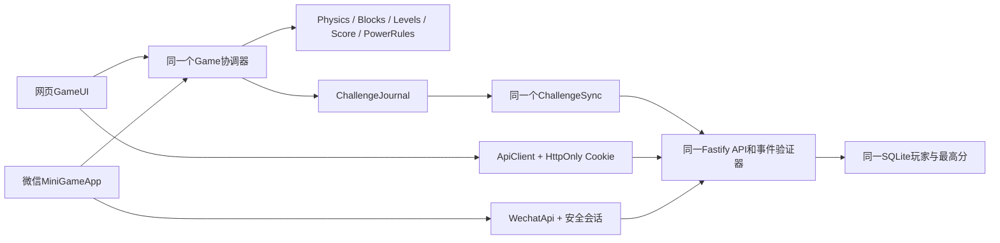

# 微信小游戏架构与变更范围

选择微信小游戏原生Canvas运行环境，而非普通小程序web-view。现有核心已支持无HTMLCanvas驱动，因此保留src中的规则文件，避免为移动端复制/搬迁一整套规则导致后端验证漂移。

## 实际文件职责

- src/Game.ts：只注入AudioSystem，协调状态与规则没有改动。
- src/Renderer.ts：新增RendererHost，支持微信Canvas/cache/尺寸/DPR；同一draw实现绘制方块、围墙、外框、挡板、机关及粒子。
- src/Audio.ts：注入上下文工厂，网页用AudioContext，微信用createWebAudioContext，不支持时静音降级。
- shared/ApiTransport.ts、src/online/ChallengeSync.ts：共用传输接口、同格式事件/摘要/批次幂等，时钟和客户端幂等ID可注入。
- minigame/src/game.ts：小游戏入口和RAF驱动；App.ts负责协调原Game、HUD、菜单、结算和联网，CanvasAdapter/Panel/Layout/Api/Policies分担平台逻辑。
- minigame/scripts：构建独立game.js和工程配置；公开AppID/apiBase可本地配置，拒绝Secret混入。
- server/src/wechat.ts：官方换码、身份摘要、会话及原玩家关联。app.ts区分Cookie/Bearer并复用原昵称与挑战路由，迁移003只追加表。
- src/online/LeaderboardUI.ts：网页增加一次性微信绑定码入口；主游戏UI和Cookie身份维持。

## 安全与生命周期

Canvas尺寸按CSS逻辑视口和安全区等比缩放，物理仍为800×1120；屏幕DPR最高2。挡板只水平控制，所有几何与死亡规则来自既有配置。

wx.onHide暂停并停止推进；onShow仅恢复画面，必须主动继续。异步登录在后台完成也不能变成自动前台发射。联网失败不阻塞单机；选择单机时不继承上一轮联网标记。所有球、机关和粒子仍由原对象池/数组管理，不新增DOM或独立物理刚体。

微信登录不开Cookie降级或信任openid输入；一次性网页绑定同时要求有效网页账号凭据和真实微信身份，不能自动合并已有两份玩家历史。原版规则与成绩验证标识不变；尚未做服务端物理回放，不声称完全防作弊。
