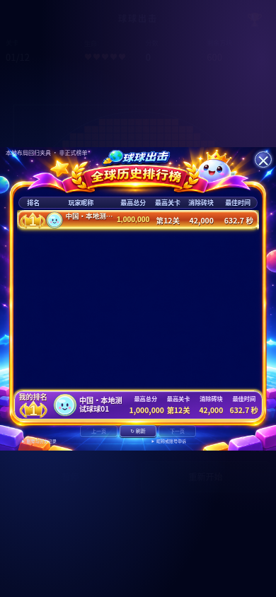
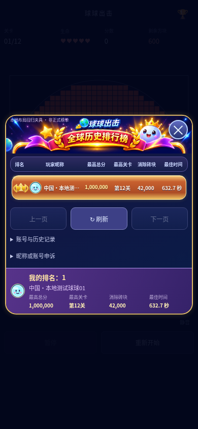

# 成绩提交协议与排行榜布局修复

## 已确认的代码问题与线上验证边界

错误前缀「本轮挑战已失效」只来自 `ChallengeSync.flush()` 的日志批次上传失败分支，**不是最终成绩摘要校验分支**。原代码把400、401、403、404、409、410、422统一永久标为失效，导致格式不兼容也无法手动重试，UI却又提示可以重试。

`dropId` 曾新增到客户端power事件及后端strict schema，但玩法规则号仍然是 `1.2.0-arcade-5l-12lv-v1`。旧API即使宣称支持此规则，仍会把 `events[n].dropId` 当作额外字段拒绝；健康检查此前没有独立日志协议标识，部署门禁也无法识别这种混合版本。旧错误处理又把所有Zod错误压成「提交内容格式不正确」，没有具体字段。

回归测试明确复现了旧strict power schema拒绝`dropId`；当前main的schema本身已经支持该字段。**开发环境访问线上健康接口被出站代理拒绝（CONNECT 403，不是业务API返回403），未读取到线上实际部署版本，也未获得该局原始日志。因此不能把线上具体拒绝字段冒充为已现场确认。** 已请求提供不含凭据的错误响应；更新后API会返回可直接定位的安全字段路径。

检查确认：Game/ScoreSystem/ChallengeJournal仍输出整数分数、tick、砖块计数和整数毫秒，不从UI的「428.9秒」字符串反解析成绩。玩法与版本号不改。

## 提交修复

1. 独立 `CHALLENGE_PROTOCOL_VERSION=2`，在health和创建挑战响应中声明；客户端同时校验规则和日志协议，两次握手都通过才上传事件。不删除`dropId`来迁就旧后端。
2. 事件解析采用同等严格的discriminated union；未知字段、类型、范围约束保留。Zod错误返回 `VALIDATION_ERROR` 与 `events[0].dropId`、`summary.score` 等路径。
3. 诊断只包含白名单字段名称、数组索引、错误类型，不返回输入值、任意用户自定义键、Cookie、Token或密钥。
4. 400/413/422上传失败暂停自动发送，保留pending批次、序号和原挑战；手动重试才重新发送相同批次。真正的身份/挑战失效仍不能伪装成可恢复。
5. UI读取明确的可重试状态，不再对永久失效的记录承诺「重试即可」。所有失败均恢复按钮，未成功记录不清空，提交幂等键保持。
6. 正式发布健康门禁要求协议2，防止再次用相同规则号掩盖后端过旧。

同一规则版本的旧客户端仍可使用原请求字段；服务器没有强制向旧日志补造dropId，也没有修改历史记录。

## 同摘要回归与反作弊

`server/tests/submission-protocol.test.ts` 使用真实Blocks、道具回调、ScoreSystem、ChallengeJournal生成受控规则日志，得到：

- 总分186045
- 到达第4关
- 消除6013块
- 时长428900毫秒

完整日志分批经过本地Fastify API提交，结果verified；总分篡改+1仍返回422，重复同幂等键只保留一条成绩。格式异常与非法dropId仍被拒绝。

这是**相同摘要的确定性规则回调夹具，不是对玩家实际弹球轨迹的回放，也不是声称找回了该局原始日志**。既有事件回放、速度/时间异常隔离、身份、CSRF、限流与SQL参数化保持，不声称浏览器计分能彻底防作弊。

原标签页若仍运行旧脚本且已永久标记fatal，不能承诺该局会在后端更新后自动恢复；刷新也可能丢失内存日志。本次不凭显示总分补写成绩、不伪造成绩、不覆盖旧账号或历史分数。

## 布局根因与修复

原排行榜将列表和个人卡绝对定位到固定1200×1320画布，个人栏在80.303%处；少量数据不会缩短空白。登记视图还固定到最高850px，并将个人栏固定在弹窗底部，容易挤占表单。原生dialog的上下inset同时为0，在移除比例约束后auto高度也可能拉满视口。

- Web改为内容驱动的弹窗：上方品牌、独立滚动列表、操作区、个人卡按正常flex流排列；显式解除原生dialog上下拉伸。个人卡是弹窗子项，不定位到页面。
- 少量数据和空榜自然收缩；长榜单仅列表滚动。个人头像限制为桌面32px/手机28px，真实名次、昵称、分数和关卡重新分组。
- 登记成绩视图隐藏个人卡，表单独立滚动；提交按钮无覆盖层。查看榜单后仍可返回本次成绩登记。
- 微信使用内容/视口驱动的面板几何，小榜不保留十行空白；个人头像24px，个人卡固定在面板的操作区之后。仍复用离屏缓存与同一数据模型。
- 前5金色荣耀保留，减弱阴影、流光透明度与星芒尺寸。

同一份main代码归档构建作为本地修复前对照，均使用明确标记的测试数据：

| 视口 | 修复前单行到操作区间距 | 修复后 |
| --- | ---: | ---: |
| 桌面1366×768 | 496.9px | 15px |
| 手机390×844 | 277.6px | 15px |
| 窄屏320×568 | 227.8px | 15px |

## 测试和截图

前端246项、后端66项、部署回归37项、微信与兼容小游戏各5项通过；类型检查及前后端/小游戏构建通过。

浏览器覆盖长榜、单条、空榜、榜单滚动、个人栏边界、头像尺寸、提交按钮可见、格式400恢复后原批次重试、422重试、暂停/后台、微信竖屏。均为本地mock或隔离SQLite API，没有正式玩家成绩提交；微信模拟宿主不替代真机验收。

| 修复前 | 修复后 |
| --- | --- |
|  |  |

[桌面](submission-layout-screenshots/after-desktop.png) · [提交按钮无遮挡](submission-layout-screenshots/submit-mobile.png) · [微信竖屏模拟](submission-layout-screenshots/wechat-mobile.png)

```bash
npm run typecheck
npm test
npm run build
npm run typecheck --prefix server
npm test --prefix server
npm run build --prefix server
npm run test:deploy
npm run test:wechat
npm run test:minigame
# 预览启动后，在另一终端运行
npm run preview -- --port 4173
node tests/browser-ranking-layout-fix.mjs
EVENT_SCHEMA_FAIL=1 node tests/browser-power-submission.mjs
node tests/browser-power-submission.mjs
npm run test:browser:galactic
npm run test:browser:wechat
```

浏览器完整报告在忽略提交的`work/ranking-layout-fix/`、`work/submission-schema/`、`work/galactic-ranking/`。本地修复前对照归档在`work/layout-before`，并非服务器目录。

## 发布顺序与回滚

本次只提交代码，不部署。审核后必须**先更新后端**，确认只读健康接口包含：

```json
{"ok":true,"rulesVersion":"1.2.0-arcade-5l-12lv-v1","challengeProtocolVersion":2}
```

再发布同一审核提交的Web和微信客户端。不能只上传前端，也不能用删除未知字段或忽略服务端验证解决兼容问题。

没有数据库结构迁移，不需要清库、重建、重置身份或修改历史成绩。使用现有保留数据库的正常发布流程，禁止reset/fresh-database模式。程序回滚需配套回退兼容的前后端，不删除、覆盖或回滚数据库。未SSH、未重启服务、未改Nginx或《统帅三国》。

## 文件范围

协议与诊断：`shared/Challenge.ts`、`server/src/app.ts`、`server/src/validation.ts`、`src/online/ChallengeSync.ts`、生产健康门禁及其测试。

布局：`src/online/LeaderboardUI.ts`、`src/online/ranking/reference.css`、`ReferenceLayout.ts`、`wechat-game/src/RankingCanvas.ts`。

回归：提交协议服务端测试、客户端错误分类测试、紧凑布局单测、浏览器布局/提交/双端场景夹具，以及本说明和截图。核心物理、计分和数据库代码没有修改。
