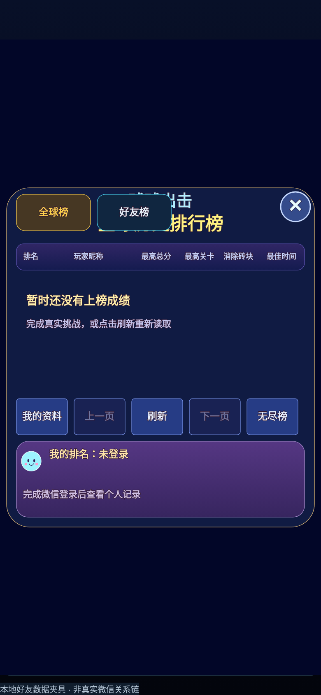
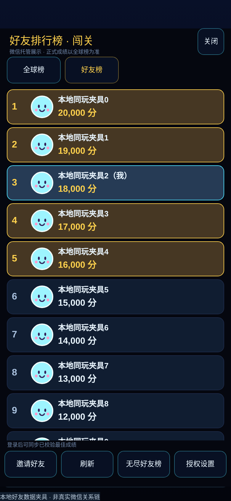
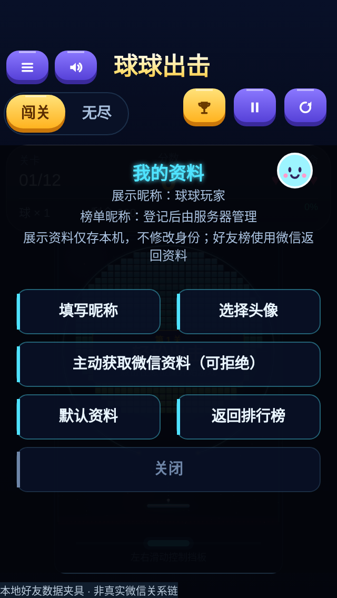

# V2.1 微信社交功能交付

基于 main `28d144a`（实际客户端已为2.3.0），新增社交功能标识 `2.1.0-social`，不降低现有客户端版本。保留全屏选择页、闯关/无尽、顶部切换和奖杯位置。

## 1. 已实现与边界

- 全球榜增加「全球榜 / 好友榜」选项，保留原TOP100、分页、个人名次和闯关/无尽切换；好友榜由独立开放数据域绘制，主域只绘制容器并转发尺寸、模式、滚动、刷新、显示/隐藏消息。
- 好友榜显示微信返回的同玩好友头像、昵称、最高分、顺序排名；前五金色强调、当前用户青色高亮。没有头像时使用统一球球默认头像。空榜和错误都提供刷新/邀请入口；授权设置可由用户主动打开。
- 闯关与无尽独立键，并把当前规则版本纳入键和值，防止不同难度/规则混排；没有改变原规则版本。未返回的好友不虚构补位。
- 腾讯云身份与最佳成绩继续作为客户端同步入口依据。提交返回verified后才触发该次同步；返回quarantined不把本轮分数写入。登录、前台恢复或主动刷新也可重新查询服务端既有有效best，避免离线/重启丢失重试意图；不从本地成绩、分享参数或存储中的待上传分数构造可信候选。
- 分享成绩：本局结束后使用当前模式与最终得分生成原创500×400深海蓝卡片；注明以服务器校验为准，无用户隐私、身份凭据或密钥。支持主动分享及菜单分享；导出失败/超时退化为文字；不使用分享成功回调发奖，不诱导分享。
- 「我的资料」入口在全球榜下方操作栏。用户主动填写2～12字符本机展示昵称、从相册选头像并保存到小游戏私有目录；可使用原生微信资料按钮主动授权，也可拒绝或保留默认。**展示资料仅存本机，不修改服务器榜单昵称/身份；好友榜昵称头像由微信实际返回。** 修改正式榜单资料仍使用已有服务端管理/申诉流程。

### 必须如实说明的安全限制

好友云存储是微信客户端可写能力，不等于腾讯云挑战回放验证。正常客户端仅把已认证 `/me/best` 返回的有效最佳成绩送交开放数据域，校验模式/规则元数据、复核身份未变化；开放数据域读取当前云值后仅写入更高候选，并按模式串行处理、保留失败候选供刷新重试。

但篡改客户端仍可能直接调用微信写入API/伪造主域消息，云记录没有服务器签名或回放证明。微信接口也不提供CAS原子比较更新，极端跨设备并发仍有竞态，无法保证对抗性场景下只增不减。客户端不能把好友榜宣称为与全球榜同等可信的正式排名，也不能完整同步服务端封禁/人工复核变化。**正式有效成绩与裁决始终以腾讯云全球榜为准。** 后续若需增强可信度，应评估官方服务端托管数据写入/回放证明方案及AppID权限，而不是混淆JavaScript或在客户端放密钥。

本版云键按规则隔离，历史全球成绩不变；没有删除任何云记录的逻辑。微信限制每用户128个KV、单项key+value不超过1024字节、key不超过128字节，本版使用两个当前规则键，值约百余字节。未来版本积累需设计保留策略，不能擅自清理全球历史。

当前玩家高亮通过开放数据域读取本人托管记录中的随机展示标记匹配，不向主域传openid，也不将该标记用作账号认证。若微信未返回本人行或数据尚未一致，不伪造本人排名，刷新后以实际返回为准。

## 2. 官方能力核对与降级

核对日期：2026-11-13。官网接口页面在本环境无法直接打开，使用微信官方维护的 [minigame-api-typings](https://github.com/wechat-miniprogram/minigame-api-typings/blob/42c427aa8c3961b7a4f8ea5bd6112c2bcf058177/types/wx/lib.wx.api.d.ts)（HEAD `42c427aa8c3961b7a4f8ea5bd6112c2bcf058177`）核对接口参数、注释与其指向的官方文档。没有以第三方聚合文章代替权限确认。账号资质、后台开通状态及最新微信客户端行为仍须维护者在官方后台/真机核实。

| 能力 | 官方说明/本版处理 |
|---|---|
| [getFriendCloudStorage](https://developers.weixin.qq.com/minigame/dev/api/open-api/data/wx.getFriendCloudStorage.html) | 类型声明标注基础库1.9.92、仅开放数据域、需要用户授权；仅返回平台允许的同玩好友，新好友可能有延迟，不是完整通讯录。scope为 `scope.WxFriendInteraction`。拒绝时显示错误/设置入口，全球榜与单机不受影响。 |
| [getUserCloudStorage](https://developers.weixin.qq.com/minigame/dev/api/open-api/data/wx.getUserCloudStorage.html) / [setUserCloudStorage](https://developers.weixin.qq.com/minigame/dev/api/open-api/data/wx.setUserCloudStorage.html) | 开放数据域内读取本人数据；本版写入也留在开放数据域。比较当前最高值、模式串行、防重复和失败重试；不把其称为服务端反作弊。 |
| [getOpenDataContext](https://developers.weixin.qq.com/minigame/dev/api/open-api/context/wx.getOpenDataContext.html) / [sharedCanvas](https://developers.weixin.qq.com/minigame/dev/api/open-api/data/wx.getSharedCanvas.html) | 基础库1.9.92；主域通过postMessage发送简单类型消息并合成canvas，不能直接获取好友名单。缺失或调用异常时仅关闭好友能力，保留全球榜和游戏。 |
| [createUserInfoButton](https://developers.weixin.qq.com/minigame/dev/api/open-api/user-info/wx.createUserInfoButton.html) | 类型声明标注2.0.1；仅在用户主动点击资料入口后、能力存在时创建，withCredentials=false，不读取encryptedData、rawData或静默getUserInfo。接口及昵称头像政策变化可能只返回默认资料，不能保证真实微信资料。按钮离页/后台/尺寸变化销毁。 |
| [chooseMedia](https://developers.weixin.qq.com/minigame/dev/api/media/video/wx.chooseMedia.html) | 类型声明标注2.23.0，用户主动选择相册图片、私有文件保存；缺能力/拒绝时保留默认。普通小程序button的chooseAvatar/input昵称组件不是本原生小游戏的可用DOM控件，不照搬。 |
| [shareAppMessage](https://developers.weixin.qq.com/minigame/dev/api/share/wx.shareAppMessage.html) / showShareMenu / onShareAppMessage | 使用现有官方分享接口，只传title/imageUrl/query，不依赖success/cancel代表真实转发完成，不承诺可追踪分享成功。真实分享图片需在真机验证；无导出能力时文字仍可分享。 |

## 3. 文件结构与数据流

```text
wechat-game/
  game.json                       # openDataContext: open-data
  open-data/
    game.ts                       # 开放数据域独立入口
    Runtime.ts                    # 微信好友读取/云纪录比较写入/滚动绘制
  src/social/
    Protocol.ts                   # 两模式键、规则与云值校验（纯类型/纯函数）
    CloudSync.ts                  # 已认证服务器best → 单向消息
    FriendBoard.ts                # 主域容器、导航和滚动消息
    Profile.ts                    # 主动、本机展示资料，不涉及服务器身份
    Share.ts                      # 原创卡片和分享参数
  dist/
    game.js
    game.json
    open-data/game.js             # 真正独立的bundle
```

构建检查开放数据域不得引入主域Game/Api/服务器代码或网络请求。开放数据域不向主域发送好友信息；唯一关系链网络调用由微信原生API完成。头像图像缓存在开放数据域内最多64项，只绘制视口内行；没有独立动画循环，后台消息冻结绘制。主域暂停/恢复原游戏规则不变。

新增云同步仅请求已有 `/api/me?board=global`、`/api/me/best?board=global|endless`。服务器查询本来就筛选verified；重复游戏提交继续由原ChallengeSync幂等键处理。社交功能不创建新账号，不以昵称/头像/openid作为客户端认证凭据。

## 4. 后台配置

1. 使用已有的真实**微信小游戏AppID**，开发者/体验成员具备对应权限。游客AppID只能运行降级，不代表好友API或正式登录成功。
2. `game.json` 的开放数据域目录和产物已自动构建，无需配置成普通小程序页面或WebView。
3. 在后台核实该主体可使用同玩好友关系链/开放数据域，并配置需要的隐私保护指引：朋友信息、头像昵称、用户主动选择的图片及本机保存用途；用户可拒绝且不阻断核心游戏。具体后台名称和资质要求以当前账号官方界面为准，不假设自动开通。
4. request合法域名保持 `https://ball.gmgnclaw.com`；头像的显示与相册读取按微信平台规则处理，不为获取朋友信息新增腾讯云接口。不关闭域名检查绕过权限。
5. 分享菜单、好友可见性及用户资料按钮在当前基础库真机验证。好友可能未玩过该游戏、拒绝授权或暂无当前规则云记录，这些情况不补造数据。
6. 无新增后端环境变量/迁移/数据库或Nginx修改。AppSecret仍仅由现有服务器配置管理，客户端只填公开AppID。

## 5. 构建与测试

```bash
npm ci
npm run typecheck
npm test
npm run build
npm run test:wechat
npm run test:minigame
npm run typecheck --prefix server
npm test --prefix server
npm run build --prefix server
npm run test:deploy
node tests/browser-wechat-social.mjs
npm run test:browser:wechat
```

实际结果：前端381项（社交14项）通过、服务端89项通过、部署47项通过；微信与兼容小游戏类型检查/构建测试各6项通过；网页与后端构建通过。原微信兼容浏览器流程通过（本地隔离数据库真实碰撞、提交、登录和多球），新增社交模拟宿主覆盖320/390/430/768宽、全球→好友切换、空/错状态、滚动、本人标记、后台停止绘制与分享图片导出。所有测试失败均已修复，没有跳过或关闭服务端校验。

[社交浏览器报告](wechat-social/browser-results.json) · [原流程兼容报告](wechat-social/compatibility-results.json)。两个报告明确标注模拟环境，不是正式微信或真机结果。

| 全球榜入口 | 好友榜（本地测试夹具） | 资料页 |
|---|---|---|
|  |  |  |

[空榜](wechat-social/empty-390.png) · [错误](wechat-social/error-320.png) · [分享卡片（本地流程0分）](wechat-social/share-card.png)。好友截图全部为带水印的本地夹具，非真实关系链，未写入生产玩家数据。

微信独立构建：`npm run build:wechat`；开发者工具准确导入 **`wechat-game/dist`**。构建先完成主域和开放域到同一临时目录，再整体替换输出，避免不配套产物。正式候选 `npm run release:wechat` 要求 `wechat-game/local.config.json` 已填写真实AppID，默认API仍为正式HTTPS；该配置被gitignore排除。

### 上传命令（仅供维护者确认后手动运行，本次没有执行）

PowerShell，先在仓库根目录构建；无需提供密码或Token，使用已登录的官方开发者工具：

```powershell
npm ci
npm run release:wechat
$Project = (Resolve-Path .\wechat-game\dist).Path
$Cli = 'C:\Program Files (x86)\Tencent\微信web开发者工具\cli.bat'
# 安装在其他目录时只修改上面的路径，并在开发者工具中启用CLI服务端口。
if (-not (Test-Path $Cli)) { throw '请填写已安装的官方开发者工具cli.bat路径' }
& $Cli open --project $Project
& $Cli upload --help
# 先完成下面的真机清单并核对本机CLI参数，再运行上传；不自动提交审核。
$UploadVersion = Read-Host '请输入本次微信上传版本（不要降低已上传版本）'
& $Cli upload --project $Project --version $UploadVersion --desc '球球出击：好友榜、成绩分享和自愿资料设置'
```

本环境无微信开发者工具，未执行或冒充验证真实上传。若本机工具版本没有upload子命令，使用导入工程后的官方右上角「上传」，不使用第三方权限绕过。上传开发版本不会由本脚本撤回、替换或提交V1.0审核；具体版本管理操作由维护者确认。

## 6. 真机验收（尚未执行，不能以模拟测试勾选）

- [ ] 安卓与iPhone各一台，真实AppID/同一版本，检查刘海/胶囊、DPR、头像、文本、滚动与关闭按钮。
- [ ] 两个彼此同玩的真实微信好友账号，同意朋友授权；正常游玩并获得服务器verified记录后，分别检查闯关/无尽独立榜。新好友和云数据延迟需等平台同步，不伪造正式玩家成绩。
- [ ] 拒绝朋友授权、关闭网络、无好友或好友无云记录：看到准确空/错状态，仍可全球榜和单机；恢复网络/授权后刷新可重试。
- [ ] 已有老账号登录后玩家ID、昵称地区、历史成绩保持原样，profile修改不会改全球榜记录；清理展示资料后仍能原账号登录。
- [ ] 主动拒绝用户资料授权，默认头像/昵称可用；主动选头像、手动昵称及再次进入持久化；不支持该能力时明确降级。
- [ ] 完成正常挑战、提交verified后云纪录只提升；低分/重复提交不降纪录，隔离复核记录不成为新的好友分数；退出重进后服务端best可重取。云写失败刷新重试。
- [ ] 结算分享图片显示实际模式/本次分数、无隐私字段；好友收到可打开正确游戏入口；取消分享不发奖、不影响对局。
- [ ] 切后台/回前台，物理保持原暂停规则，好友绘制停止/重开；缩放/分屏后共享画布与触摸匹配。

## 7. 交付范围

仅微信客户端、开放数据域、必要测试、README/CHANGELOG和本说明。未改游戏核心、规则版本、全球榜排序、服务器或部署脚本。未部署腾讯云、未上传微信、未提交审核、未撤回V1.0、未修改统帅三国。

## 8. 实际修改文件清单

```text
CHANGELOG.md
README.md
docs/WECHAT_SOCIAL_V21.md
docs/wechat-social/browser-results.json
docs/wechat-social/compatibility-results.json
docs/wechat-social/empty-390.png
docs/wechat-social/error-320.png
docs/wechat-social/friends-390.png
docs/wechat-social/global-390.png
docs/wechat-social/profile-320.png
docs/wechat-social/share-card.png
tests/browser-wechat-social.mjs
tests/wechat-social.test.ts
wechat-game/README.md
wechat-game/game.json
wechat-game/open-data/Runtime.ts
wechat-game/open-data/game.ts
wechat-game/scripts/build-test-suite.mjs
wechat-game/scripts/build.mjs
wechat-game/src/App.ts
wechat-game/src/Panel.ts
wechat-game/src/Platform.ts
wechat-game/src/Policies.ts
wechat-game/src/RankingCanvas.ts
wechat-game/src/social/CloudSync.ts
wechat-game/src/social/FriendBoard.ts
wechat-game/src/social/Profile.ts
wechat-game/src/social/Protocol.ts
wechat-game/src/social/Share.ts
wechat-game/tsconfig.json
```
