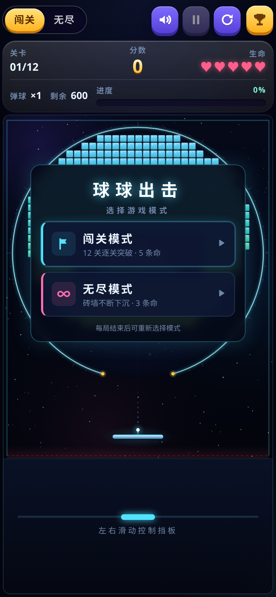
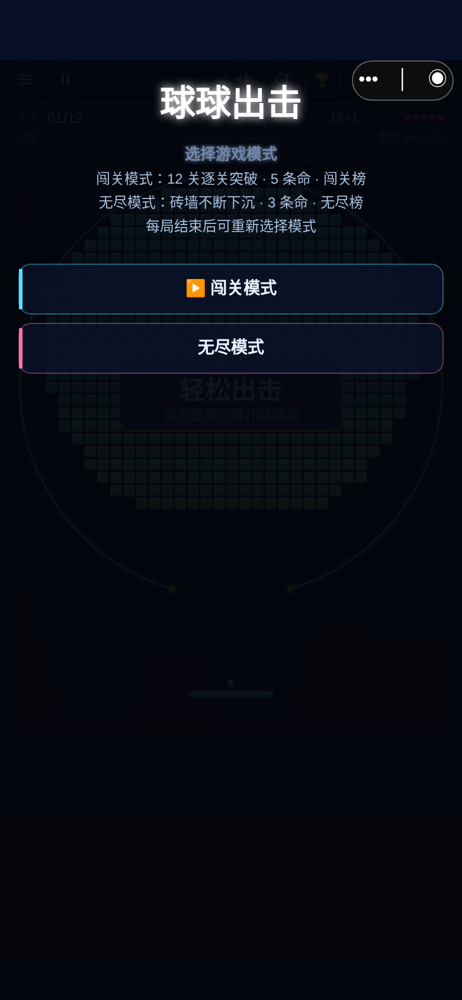
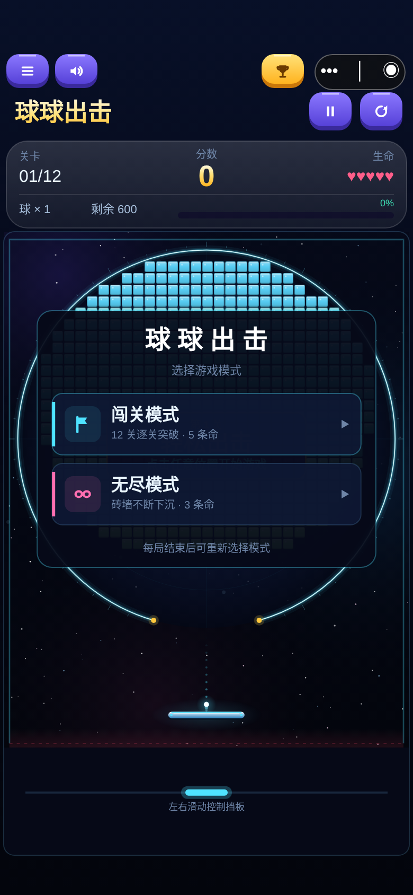

# 微信小游戏进入界面对齐

基线：main `26a6b4a`（V2.2.2）。本次沿用仓库实际版本，不降低版本号或变更线上审核版本。

## 原因与修改

网页版 `src/GameUI.ts`、`src/style.css` 已使用球场中央玻璃卡片、两张带图标/说明/箭头的模式卡及金色大分数 HUD；微信 `Panel.ts` 把模式选择当成通用全屏文本面板，遮住球场。微信原来的顶栏未绘制游戏标题，40px HUD 信息层级与网页不一致，且模式面板打开时不绘制底部操作区域，形成空白。

- 新增 `wechat-game/src/ModePicker.ts`：按网页 `.mode-picker/.pick-icon/.pick-text/.pick-go` 结构绘制中央卡片。青色闯关、粉色无尽，沿用共享 Icons 和 OCEAN 字体/色值；不依赖 DOM/CSS 引擎。
- 新增 `wechat-game/src/GameChrome.ts`：只读 Game 状态，绘制关卡/阶段、金色分数、真实生命、球数、剩余砖块或下沉信息及进度条。保留空心失去生命的显示。
- `Layout.ts`：胶囊同排仅放菜单、声音、排行榜；标题与暂停/重开在下一行，82px双层HUD随后。相机仍使用原 VIEW 772×982 的等比例显示，物理坐标和竞技场/挡板尺寸不变。
- `App.ts`：用网页对应紫色/金色按钮；点击区域44×44 CSS像素且不重叠。底部剩余空间继续作为滑动操作区，模式选择时也绘制，减少无意义空白。
- `Panel.ts`：仅给模式选择使用专用渲染；继续使用原 actions、tap 和 chooseMode 路径。不变更登录、授权、排行榜、提交、菜单或结算业务。

未改 shared/CanvasUI.ts、shared/VisualTheme.ts 和网页样式：现有共享组件和主题已经具备所需颜色、图标和按钮原语，直接复用即可。没有变更任何玩法、规则版本、关卡、道具、计分、ChallengeJournal、身份、API或server文件。

## 实测与限制

- 前端/共享单元测试：346项通过，含新增9项布局、真实触摸选模式及窗口变化回归。
- 后端89项、部署47项、微信构建5项、兼容小游戏构建5项通过。
- 网页、微信、兼容小游戏和服务端类型检查/构建通过。
- Chromium wx模拟宿主：320×568、375×812、390×844、430×932、412×915，分别配置顶部安全区20/44/47/59/24、底部安全区及胶囊矩形；检查卡片、触控边界、按钮互不重叠、不覆盖胶囊、比例、两种模式选择和无页面异常。单测额外覆盖768×1024。
- 原 `npm run test:browser:wechat` 通过：三个视口的真实触摸、碰撞、道具、生命、隔离数据库成绩提交及压力场景（非生产请求）。数据见 [兼容报告](wechat-ui-alignment/compatibility-results.json)。
- [布局原始报告](wechat-ui-alignment/results.json)。这是Chromium模拟微信Canvas宿主，不是微信开发者工具或安卓/iPhone真机测试；不能据此保证实际设备帧率。原压力脚本帧率已如实保留在报告中。

本轮消息未附新的两张用户截图，因此视觉基准是最新main中的网页版实际渲染。修改前截图来自同一main提交的独立worktree构建，修改后及网页参考使用相同390×844视口。

## 对比

| 网页基准 | 微信修改前 | 微信修改后 |
|---|---|---|
|  |  |  |

[320窄屏](wechat-ui-alignment/after-320.png) · [430大屏](wechat-ui-alignment/after-430.png) · [闯关](wechat-ui-alignment/campaign-390.png) · [无尽](wechat-ui-alignment/endless-390.png)

## 重新构建和导入

```bash
npm ci
npm run typecheck
npm test
npm run build
npm run test:wechat
```

单独构建微信包：`npm run build:wechat`。开发者工具导入仓库内 **`wechat-game/dist`**，不要导入仓库根目录或网页dist。真实AppID仍在 `wechat-game/local.config.json`（不提交），后端配置和凭据无需修改。完成开发者工具检查后再由维护者自行安排真机测试/上传；本次没有上传、部署、撤回审核或合并main。

浏览器截图复现：先 `npm run dev -- --port 4173`，另终端运行 `npm run build:wechat && node tests/browser-wechat-alignment.mjs`（需要Chromium，默认 `/usr/bin/chromium`）。
