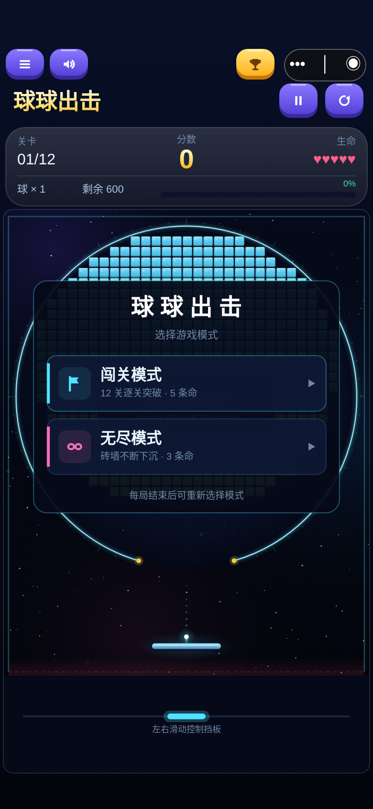
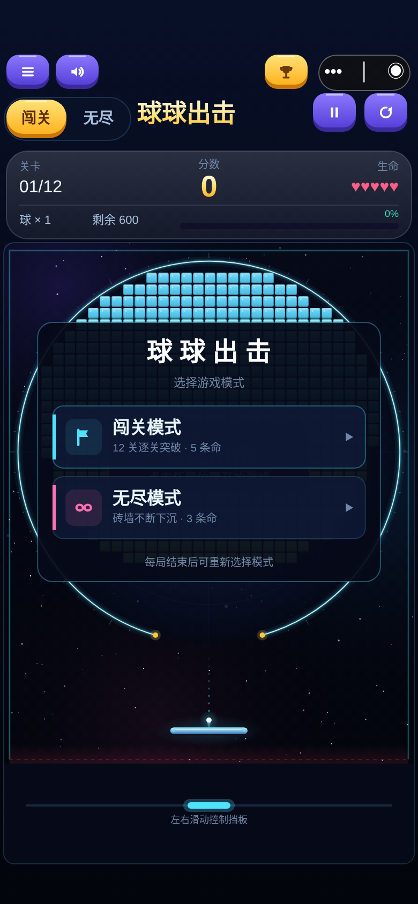

# 微信顶部「闯关 / 无尽」常驻入口

基线：main `b347183`。本次补全顶部UI入口，不是继续修改触摸兼容或开发社交功能。

## 变更

- `wechat-game/src/Layout.ts`：在标题行左侧定义两枚56×44 CSS像素的模式命中区。标题行增加8px，避免与上方菜单/声音/榜单触摸区交叠；仍保持原相机宽高比与物理坐标。
- `wechat-game/src/App.ts`：常驻绘制网页同风格双模式胶囊，当前项金色高亮。标题与暂停/重开保留在该行其他区域；菜单、声音、排行榜继续避开微信胶囊。
- 模式按钮复用 `chooseMode → Game.setMode/reset`，不引入第二套玩法。未开局直接切换；进行中（含暂停及丢命待发射）弹原生确认框，明确结束旧局且不自动上传成绩。确认后进入新模式待发射状态；取消恢复原先运行/暂停状态，保持生命、分数、砖块和日志。点击当前模式不重置未结束对局，首次模式选择时会关闭选择弹窗；结束后可从顶部开始任意模式新局。
- 确认期间暂停并锁定重复请求，记录挑战generation；过期回调不能覆盖主动重开后的新局。切换后关闭旧面板并更新HUD、5/3生命、global/endless榜单类型和已有模式偏好存储。
- 新局先回到未联网状态，仍走原始开局授权流程。没有调用submit；旧局记录不会自动登记为有效成绩。历史玩家数据和榜单完全不变。
- 普通面板从HUD位置开始绘制，保留顶部模式入口；排行榜弹窗仍可覆盖顶部，隐藏的模式按钮不会透过排行榜触发。
- 切换后调用客户端renderer.resize以刷新视觉缓存，防止新旧砖块场generation/revision重号残留旧图；不改Renderer或物理。
- `tests/wechat-top-mode-tabs.test.ts`：9项新回归，检查真实顶部触摸、模式/生命/HUD/榜单、确认/取消、当前模式不重置、结束后切换、暂停取消、过期确认与缓存刷新。
- `tests/browser-wechat-alignment.mjs`：增加五种视口的顶部入口真实wx触摸流程和确认/取消，直接断言game.mode；保留全部原模式弹窗与布局覆盖。

仅变更微信客户端和必要测试/交付文档；`src`、`shared`、`server`、数据库、规则版本和协议无变化。

## 验证

- TypeScript类型检查通过。
- 完整前端366项测试通过，包含9项新增顶部入口回归。
- 后端89项、部署47项测试通过；后端类型检查及构建通过。
- 网页构建、微信类型检查/构建及5项构建测试通过；兼容小游戏构建及5项测试通过。
- Chromium微信Canvas模拟宿主覆盖320×568、375×812、390×844、430×932、412×915，检查胶囊/安全区/命中区域不交叠、模式选择、运行中取消与确认。单测另覆盖DPR1/2/3。
- 原微信兼容浏览器测试通过（真实碰撞、道具、生命、隔离数据库成绩提交及多球压力场景）。所有API测试使用本地隔离环境，未接触正式数据库。
- 安卓/iPhone真机与微信开发者工具本环境不可用，需维护者复测；不把模拟宿主报告当作真机验收。

## 截图

截图来自相同390×844视口。修改前来自基线独立worktree构建，修改后来自本分支。无虚构成绩或玩家。

| 修改前 | 修改后 |
|---|---|
|  |  |

[闯关待发射](wechat-top-mode-tabs/campaign-390.png) · [无尽模式](wechat-top-mode-tabs/endless-390.png) · [320窄屏](wechat-top-mode-tabs/after-320.png)

## 重新构建

```bash
npm ci
npm run typecheck
npm test
npm run build:wechat
```

微信开发者工具导入仓库中的 **`wechat-game/dist`**。真实AppID仍在未提交的`wechat-game/local.config.json`，无后端更新需要。由维护者自行安排真机验证；本次不合并、不上传微信、不撤回V1.0审核、不部署腾讯云、不操作统帅三国。
